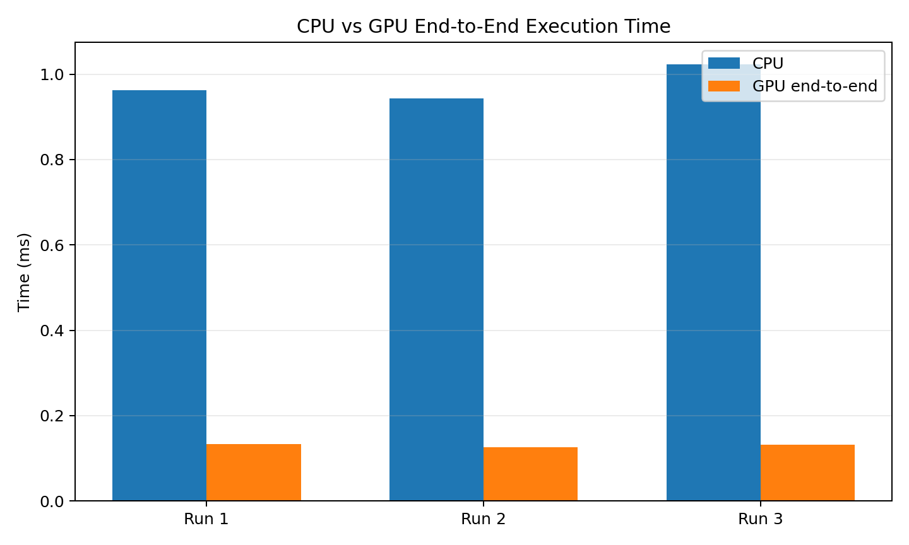
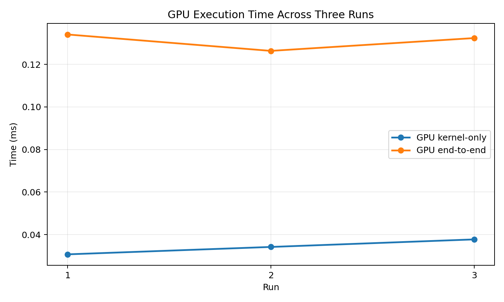
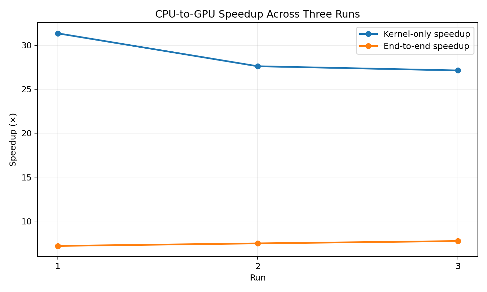
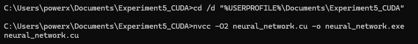
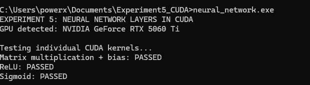
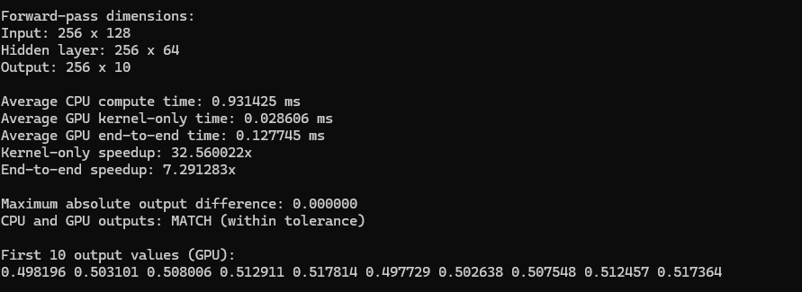

# Experiment 5: Neural Network Layers in CUDA

## 1. Aim

To implement basic neural-network layers using CUDA and compare their execution performance on the CPU and GPU.

## 2. Introduction

CUDA (Compute Unified Device Architecture) is NVIDIA's parallel computing platform. It allows suitable computations to run in parallel on an NVIDIA GPU.

In this experiment, a two-layer neural-network **forward pass** is implemented on both the CPU and GPU. The results are compared to verify correctness and measure execution time.

## 3. Operations Implemented

The program implements these operations:

1. Matrix multiplication with bias
2. ReLU activation
3. Sigmoid activation

### Forward-pass equations

```text
Z1 = X × W1 + b1
A1 = ReLU(Z1)
Z2 = A1 × W2 + b2
Y  = Sigmoid(Z2)
```

### Network dimensions

| Layer | Dimensions |
|---|---:|
| Input | 256 × 128 |
| Hidden layer | 256 × 64 |
| Output | 256 × 10 |

**Scope:** This experiment implements forward propagation only. It does not include model training or backpropagation.

## 4. Hardware and Software

| Component | Specification |
|---|---|
| GPU | NVIDIA GeForce RTX 5060 Ti (16 GB) |
| Operating system | Windows 11 |
| CUDA Toolkit | 13.4.92 |
| CUDA compiler | NVIDIA NVCC |
| Build tools | Visual Studio 2026 Community |

## 5. Project Structure

```text
Experiment5_CUDA/
├── neural_network.cu
├── neural_network.exe
├── README.md
├── images/
│   ├── cpu_vs_gpu_end_to_end.png
│   ├── gpu_execution_times.png
│   └── speedup_comparison.png
└── Screenshots/
    ├── compilation.png
    ├── kernel_tests.png
    └── final_execution.png
```

## 6. Compilation and Execution

Open **Visual Studio 2026 x64 Developer Command Prompt** and navigate to the project folder:

```cmd
cd /d "%USERPROFILE%\Documents\Experiment5_CUDA"
```

Compile the CUDA source file:

```cmd
nvcc -O2 neural_network.cu -o neural_network.exe
```

Run the program:

```cmd
neural_network.exe
```

## 7. Correctness Verification

The CUDA operations were tested against the corresponding CPU calculations.

| Test | Result |
|---|---|
| Matrix multiplication with bias | PASSED |
| ReLU | PASSED |
| Sigmoid | PASSED |
| CPU and GPU output comparison | MATCH |
| Maximum absolute output difference | 0.000000 |

The CPU and GPU outputs matched within the comparison tolerance used by the program.

## 8. Performance Results

The program was executed three times. The measured times are shown below.

### Execution times

| Run | CPU compute (ms) | GPU kernel-only (ms) | GPU end-to-end (ms) |
|---|---:|---:|---:|
| 1 | 0.962320 | 0.030702 | 0.134035 |
| 2 | 0.943440 | 0.034179 | 0.126330 |
| 3 | 1.023230 | 0.037722 | 0.132350 |
| **Average** | **0.976330** | **0.034201** | **0.130905** |

### Average speedup

| Measurement | Average speedup |
|---|---:|
| GPU kernel-only | **28.69×** |
| GPU end-to-end | **7.46×** |

*Kernel-only time measures GPU kernel execution. End-to-end time includes the additional GPU-side overhead measured by the program, so it is a more inclusive comparison.*

## 9. Performance Graphs

### 9.1 CPU vs GPU end-to-end execution time

This graph compares CPU compute time with GPU end-to-end execution time for the three runs.



### 9.2 GPU execution times

This graph compares GPU kernel-only time with GPU end-to-end time.



### 9.3 Speedup comparison

This graph compares the CPU-to-GPU speedup for kernel-only and end-to-end execution.



## 10. Execution Screenshots

### 10.1 Successful compilation

The screenshot shows the CUDA program compiling successfully using NVCC.



### 10.2 CUDA kernel tests

The screenshot shows the individual operation tests passing.



### 10.3 Final program execution

The screenshot shows the program output, GPU information, execution times, speedups and CPU-GPU comparison.



## 11. Observations

1. All three CUDA operation tests passed.
2. The CPU and GPU outputs matched within the program's comparison tolerance.
3. The maximum absolute output difference was 0.000000.
4. The average GPU kernel-only speedup was 28.69×.
5. The average GPU end-to-end speedup was 7.46× for this workload.
6. The measured performance is specific to the hardware, implementation and input dimensions used in this experiment.

## 12. Conclusion

The neural-network forward pass was successfully implemented using CUDA. Matrix multiplication with bias, ReLU and Sigmoid operations were executed and tested on the GPU.

The CPU and GPU results matched, with a maximum absolute output difference of 0.000000. Across three runs, the average kernel-only speedup was 28.69× and the average end-to-end speedup was 7.46× compared with the CPU compute time.

This experiment demonstrates how CUDA can use GPU parallel processing to accelerate neural-network computations for the tested workload.

---

## Author

**Name:** Vandana A M  
**Branch:** CSE (Artificial Intelligence)  
**Course:** Parallel and GPU Computing (PGC)  
**Experiment:** 5 – Neural Network Layers in CUDA

**Technologies:** CUDA, C++, NVIDIA GPU
